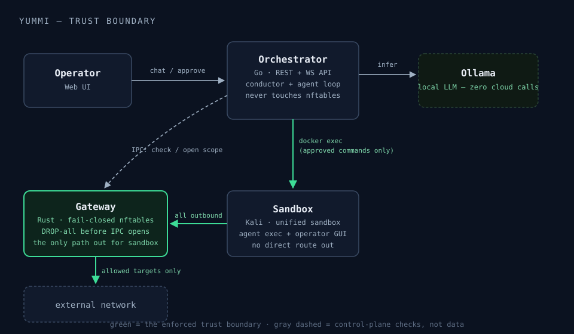

<p align="center">
  <a href="https://github.com/n0connect/yummi">
    
  </a>
</p>

<p align="center">A privacy-first, fail-closed AI pentest conductor.</p>

<p align="center">
  <a href="https://github.com/n0connect/yummi/actions/workflows/ci.yml"></a>
  <a href="LICENSE"></a>
  <a href="https://github.com/n0connect/yummi/releases"></a>
  <a href="docs/installation.md"></a>
  <a href="gateway/Cargo.toml"></a>
  <a href="ui/package.json"></a>
</p>

<p align="center">
  <b><a href="docs/README.md">📚 Full Documentation</a></b> ·
  <a href="docs/installation.md">Installation</a> ·
  <a href="docs/architecture.md">Architecture</a> ·
  <a href="docs/security-model.md">Security Model</a> ·
  <a href="docs/usage-guide.md">Usage Guide</a> ·
  <a href="docs/api-reference.md">API Reference</a>
</p>

<p align="center">
Yummi turns natural language into practical security workflows while keeping traffic control and operator authority explicit. An autonomous Red-Team agent drives a hardened Kali sandbox, while a small Rust gateway enforces the documented network policy independently of the model-facing code.
</p>

---

## Documentation

The [`docs/`](docs/) directory is the full, in-depth reference — start at **[docs/README.md](docs/README.md)** for the complete index and suggested reading paths, or jump straight to the page you need:

- **[Architecture](docs/architecture.md)** — The 5 components, network topology, core data flows
- **[Security Model](docs/security-model.md)** — Fail-closed network layer, content-layer threat scanning, audit chain
- **[Installation](docs/installation.md)** — OS/architecture-specific setup (Linux/macOS/Windows, x86_64/ARM64), common first-run errors
- **[Usage Guide](docs/usage-guide.md)** — The 7 UI tabs, approval flows, CLI
- **[Agent internals](docs/agent/overview.md)** — The graph state machine, memory, skills, sub-agents
- **[API Reference](docs/api-reference.md)** — Every REST route and WebSocket event
- **[Development](docs/development.md)** — Fast build loops, running a single test, the three-Go-modules trap

## What Yummi is

*The AI proposes, the gateway disposes.* Agent and direct-exec commands converge on one scoped execution path. The interactive terminal is a separate human-driven path: it bypasses orchestrator's target parser, but its packets still cross the gateway's kernel policy.

<p align="center">
  
</p>

Five components in total, not four — a `docker-proxy` sits between the orchestrator and the Docker socket so the orchestrator can `docker exec` into the sandbox without ever holding root-equivalent access to the whole Docker daemon. **[Full architecture →](docs/architecture.md)**

## Why it's structured this way

- **The agent never runs a command itself.** It only ever proposes one; a separate component containing no AI decides whether it's allowed to happen. **[How the agent works →](docs/agent/overview.md)**
- **Fail-closed, not fail-permissive.** The gateway installs deny-all nftables rules *before* it even opens its control socket — if it crashes, the sandbox doesn't get a free pass, it just has no rules to change. **[Security model →](docs/security-model.md)**
- **Two independent attack surfaces, two independent defenses.** A network-layer trust boundary (the gateway) *and* a content-layer threat scanner (catching prompt injection in tool output, not just bad network requests) — because a pentest target's own response is adversarial content the model has to read. **[Security model →](docs/security-model.md)**

## Quick start

```bash
make install   # prepare Yummi directories/deps, build sandbox, install/pull Ollama models
make start     # start the full stack — UI at http://localhost:3000
```

Yummi is managed entirely from that web UI. First run pulls the default model
(`gpt-oss:20b` for the full stack, ~13 GB) — see
**[Installation →](docs/installation.md)** for OS/architecture-specific setup
(Linux/macOS/Windows, x86_64/ARM64), the exact hardware sizing per model tier,
and the specific first-run errors people actually hit.

## Development

```bash
make build   # CLI + orchestrator + gateway + UI
make test    # all suites: CLI + orchestrator + gateway (cargo) + UI (vitest)
make lint    # golangci-lint, root and orchestrator modules
```

See **[docs/development.md](docs/development.md)** for fast per-component build loops, running a single test, and a real gotcha worth knowing up front: this repo is **three separate Go modules** (root CLI, `orchestrator/`, and `sandbox-mcp/`) — `go test ./...` from the repo root silently skips every orchestrator and sandbox-mcp test.

Tests favor real stores and engines. Scripted substitutes are used at external or nondeterministic boundaries such as the LLM and test HTTP servers; live suites cover the real model and sandbox when explicitly enabled.

New contributors: **[CONTRIBUTING.md](CONTRIBUTING.md)** covers the module layout, the security invariants you must not break, and commit conventions. Please also read the **[Code of Conduct](CODE_OF_CONDUCT.md)** and, for anything security-sensitive, **[SECURITY.md](SECURITY.md)**.

## License

[Apache License 2.0](LICENSE)

---

<div align="center">

Built with Go · Rust · React · Ollama. Conventional Commits.

</div>
