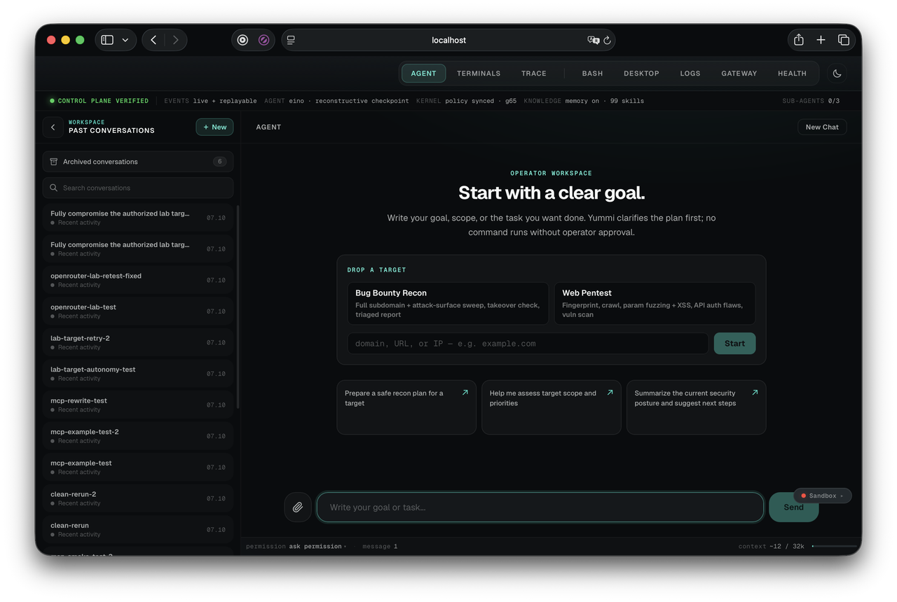

<p align="center">
  <a href="https://github.com/n0connect/yummi">
    
  </a>
</p>

<p align="center">A privacy-first, fail-closed AI pentest conductor and autonomous Red Team platform.</p>

<p align="center">
  <a href="https://github.com/n0connect/yummi/actions/workflows/ci.yml"></a>
  <a href="LICENSE"></a>
  <a href="CHANGELOG.md"></a>
  <a href="docs/installation.md"></a>
  <a href="gateway/Cargo.toml"></a>
  <a href="ui/package.json"></a>
</p>

<p align="center">
  <b><a href="docs/README.md">Full Documentation</a></b> ·
  <a href="docs/installation.md">Installation</a> ·
  <a href="docs/architecture.md">Architecture</a> ·
  <a href="docs/security-model.md">Security Model</a> ·
  <a href="docs/usage-guide.md">Usage Guide</a> ·
  <a href="docs/api-reference.md">API Reference</a>
</p>

<p align="center">
Yummi translates natural language into security workflows with recorded tool evidence while enforcing strict operator authority and fail-closed network control. An autonomous agent drives a hardened Kali Linux workbench equipped with sandbox-resident MCP tools, declarative offensive skills, and specialist sub-agents, while an independent Rust gateway enforces packet-level policy outside the model's reach.
</p>

<p align="center">
  
</p>
<p align="center"><sub>Drop a target, state a goal in one sentence, and Yummi plans before it acts. See the <a href="docs/usage-guide.md#eight-tabs">Usage Guide</a> for every tab, including a real completed run.</sub></p>

---

## Key Capabilities

### Security Boundary & Traffic Governance
- **Fail-Closed Rust Gateway** — Packet filtering is enforced by an independent Rust daemon (`yummi-gateway`) via Linux kernel `nftables` rules. Startup installs `block_all`. If the daemon terminates, its last installed rules persist; a crash does not automatically replace a previously allowed mode with lockdown. The AI agent never manages firewall rules.
- **Runtime 4-Way Egress Mode** — Operator controls egress on the fly: `block_all` (drops gateway-forwarded sandbox egress, including DNS and established flows), `block_all_except_rules` (strict scope, permits only explicitly authorized targets and active temporary rules), `allow_all` (blanket external connectivity for public destinations), or `ask_every_time` (destination-by-destination interactive operator approval). Resets to `block_all` on daemon restart.
- **Tamper-Evident Audit Chain** — Gateway policy decisions and rule/mode changes are hash-chained using SHA-256 in a local SQLite WAL journal.

### Offensive Arsenal & Pwnbox Environment
- **Unified Kali Sandbox (`yummi-pwnbox`)** — Single Kali container; tool execution runs as `1000:1000`, while the entrypoint performs privileged setup. Shares operator Bash (`tmux`), graphical desktop (`noVNC`/XFCE), and agent execution.
- **Sandbox MCP Tool Catalog** — Typed core tools, cataloged offensive utilities, Go recon pipelines, persistent tmux terminals, Chromium browser automation and sandbox-only web research. Discover names and argument schemas through MCP `tools/list`; see [Sandbox Execution](docs/agent/sandbox-execution.md).
- **Full-Capability Browser Automation** — Native Chromium automation via Rod with compact accessibility tree snapshots (`@eN` refs including semantic content elements `li`, `td`, `th`, `blockquote`, `code`), multi-tab lifecycle, session cookie isolation, and in-sandbox connection proxy for HTTP/S and WS/WSS enforcing gateway hostname policy.
- **Controlled Sandboxed Web Research** — Privacy-first research tools (`web_search`, `web_fetch`) with OpenRouter/Exa cited sources, direct HTTPS plaintext extraction/pagination/find, RFC 1918/metadata IP rejection, operator-controlled UI toggle button (`btn-web-search`), and prompt-injection defense (`UNTRUSTED_WEB_CONTENT`).
- **Persistent Tmux Terminal Verbs** — Full session lifecycle (`term_open`, `term_run`, `term_read`, `term_wait`, `term_keys`, `term_list`, `term_close`) for long-running listeners, background tunnels, reverse shells, and interactive prompts.
- **Active Directory & Network Pivoting** — Pre-staged Kerberos (`krb5-user`, `kerbrute`), Impacket, NetExec, Nishang, Metasploit Framework, OpenVPN lab profiles (`/dev/net/tun`), and an automatic reverse shell generator (`revshell`).

### Autonomous Reasoning & Specialized Agents
- **Dual Agent Backends** — An explicit 12-node Graph State Machine (closed tag protocol; model choices remain nondeterministic) or CloudWeGo's Eino ADK (native tool-calling). Both support local models and optional configured OpenAI-compatible endpoints. Model capability must be evaluated on the intended workflow; recorded runs are historical evidence, not a universal parameter-count threshold. See [Agent Overview](docs/agent/overview.md).
- **Offensive Skills & Specialist Sub-Agents** — Declarative offensive methodologies and bounded depth-1 specialist roles spanning Active Directory, Web/APIs, Cloud/K8s, Binary RE, Hardware/RF, and Adversary Emulation.
- **Active Exploit Verification Oracles** — Verification helpers (`OracleActivePoC`, `OracleDOMExecution`, `OracleOOBInteraction`, `OracleDifferential`) inspect observations. These include marker/heuristic checks and cannot guarantee the truth of every finding or model summary; review the underlying evidence.

### Operator Surface & Attack Surface Management
- **Single Web-Managed Workspace** — Clean React 18 dashboard on port 3000 featuring eight dedicated tabs: `[AGENT] [TERMINALS] [TRACE]` | `[BASH] [DESKTOP] [LOGS] [GATEWAY] [HEALTH]`.
- **Persistent Task Summary Cards** — First-class terminal summary cards with status pills, step metrics, executive summary prose, and structured findings with automatic CTF/pentest flag extraction, copy interaction, and CVE tagging.
- **On-Demand Desktop Activation** — The UI connects the noVNC viewer on demand; XFCE/VNC processes already run inside the unified sandbox.
- **Attack Surface Management (ASM)** — Hierarchical asset graph tracking domains, subdomains, IPs, ports, endpoints, query parameters, secrets, and cloud storage buckets.
- **Proxy Ingestion & Multi-Format Reporting** — An HTTP flow ingestion API for external proxy integrations, with report generation in HackerOne Markdown, Bugcrowd VRT, Executive Summary, or structured JSON.

---

## Architecture Topology

```text
                        +----------------------+
       Operator ------->|   ui (React/nginx)   |  :3000
                        +----------+-----------+
                                   | /api, /ws (proxied)
                        +----------v-----------+
                        |  orchestrator (Go)   |  internal :9080
                        |  conductor + agent   |
                        +----+------------+----+
                             |            |
                 IPC Socket  |            | Docker Exec (via docker-proxy)
        (Length-prefixed)    |            |
                        +----v-------+    |
                        | gateway    |    |
                        | (Rust)     |    |
                        | nftables   |    |
                        +----+-------+    |
                             |            |
               FORWARD Chain |            |
                (Allow/Deny) |            |
                        +----v------------v----+
                        |    sandbox (Kali)    |  Secure topology:
                        |                      |  egress gated by gateway's
                        |                      |  FORWARD chain.
                        +----------------------+
```

Five runtime components collaborate in a fail-closed architecture:
1. **orchestrator (Go)** — AI conductor, agentic state machine (Graph / Eino), execution store, and REST/WebSocket API.
2. **gateway (Rust)** — Fail-closed `nftables` policy engine, IP/hostname scope evaluator, and tamper-evident SHA-256 audit log.
3. **sandbox (Yummi Pwnbox / Kali Linux)** — Kali workbench running pentest, browser, and terminal MCP tools, Metasploit, Nishang, tmux shell, and XFCE/noVNC desktop.
4. **docker-proxy** — Repository-built Go broker; restricts requests to the configured sandbox, UID/GID `1000:1000`, allowed exec operations and broker-issued exec IDs. It has no general Docker lifecycle API.
5. **ui (React 18 + Vite)** — Modern, web-only operator surface served via nginx on port 3000.

**[Read the full architecture documentation ->](docs/architecture.md)**

---

## Documentation

Comprehensive guides and technical references live in the [`docs/`](docs/) directory. Start at **[docs/README.md](docs/README.md)**:

- **[Architecture](docs/architecture.md)** — Runtime components, isolation boundaries, and core data flows
- **[Security Model](docs/security-model.md)** — Fail-closed network design, threat scanner, and SHA-256 audit chain
- **[Installation](docs/installation.md)** — Environment prerequisites, container engines, and model setup
- **[Usage Guide](docs/usage-guide.md)** — Target-First launcher, UI tabs, approval flows, and CLI helper
- **[Agent Internals](docs/agent/overview.md)** — Graph state machine, Eino ADK, memory store, and verification oracles
- **[Skills & Sub-Agents](docs/agent/skills-and-subagents.md)** — Built-in playbooks and specialist sub-agents
- **[API Reference](docs/api-reference.md)** — Registered REST endpoints, request examples and WebSocket envelopes
- **[Development](docs/development.md)** — Multi-module Go workflow, Rust builds, and test harnesses

---

## Quick Start

### 1. Platform Prerequisites
- **Linux (x86_64 / arm64)**: Native Docker Engine (reference production platform).
- **macOS (Apple Silicon)**: Docker through OrbStack or Docker Desktop. See the [recorded engine compatibility limits](docs/installation.md#docker-desktop-internal-network-bug) before choosing network mode.
- **Windows 10/11**: **WSL2** with Ubuntu and Docker Desktop WSL2 engine (clone repo inside `~/yummi`, not `/mnt/c/`).

### 2. Bootstrap & Start

```bash
# 1. Install and start a supported Docker engine.
# Install Ollama separately if using the local model path.
# Native Go/Rust/Node toolchains are for development; see docs/installation.md.

# 2. Interactive setup wizard (run once to configure engine, language, and model)
make conf

# 3. Build missing images and start the full stack
make start
```

Yummi is managed entirely from the web UI at **`http://localhost:3000`**. The optional root CLI binary (`./bin/yummi`) opens the same web UI and provides diagnostics; its `--start`/`--stop` operate the configured sandbox service. Use Make targets for the complete stack.

### Configuration Matrix (`make conf`)

Running `make conf` writes Make syntax to gitignored `.yummi.conf`. Make command-line assignments override that file; direct `docker compose` does not load it. The wizard selects Eino, offers local/cloud/custom model setup, and can configure the optional Brain. The unconfigured Make/Compose backend default remains `graph`:

| Setting | Options | Description |
|---|---|---|
| `CONTAINER_ENGINE` | `docker`, `podman` (OrbStack uses `docker`) | Selects your container runtime. |
| `YUMMI_NETWORK_MODE` | `secure`, `insecure-bridge` | Fail-closed network mode (`insecure-bridge` removes internal-network isolation as an explicitly confirmed compatibility workaround). |
| `YUMMI_LANG` | `en`, `tr` | UI display language (compiled into the Vite bundle at build time). |
| `YUMMI_AGENT_BACKEND` | `graph`, `eino` | Tag protocol (`graph`) or native tool-calling (`eino`); the wizard writes `eino`. |
| `YUMMI_OLLAMA_MODEL` | `gpt-oss:20b`, `gpt-oss:120b`, `qwen3` | Local model; wizard blank selection is `gpt-oss:120b`, raw default is `gpt-oss:20b`. |
| `YUMMI_EINO_MODEL_API_KEY` | *(Secret input)* | Optional OpenRouter/OpenAI API key for frontier cloud reasoning models. |

The wizard currently defaults its OpenRouter model to `deepseek/deepseek-chat-v3.1`; this is a configuration default, not a current comparative recommendation. An explicit `YUMMI_EINO_MODEL_BASE_URL` changes the conductor and graph planning/chat client as well as the Eino loop. Hosted models send their input to that provider; use the local path when local-only inference is required.

After source or UI-language changes, use `make start BUILD=1` (or `make rebase`). Plain `make start` reuses existing images. Both host ports 3000 and 9080 pass through UI nginx; the orchestrator publishes neither port directly.

---

## Development

```bash
make _build-cli _build-orchestrator _build-gateway _build-ui  # Native developer outputs
make test    # CLI, orchestrator, gateway, UI, Docker sandbox-MCP, Brain and QC tests
make lint    # Runs golangci-lint across all three Go modules
# Use Docker for sandbox-MCP builds/tests: make _test-sandbox-mcp
```

> **Note:** The repository consists of **three separate Go modules** (root CLI, `orchestrator/`, and `sandbox-mcp/`). Run orchestrator tests from `orchestrator/`; sandbox-MCP tests must use Docker (`make _test-sandbox-mcp`). The legacy aggregate `make build` still includes a host sandbox-MCP target; use the granular native targets above and the Docker path for sandbox-MCP. See **[docs/development.md](docs/development.md)**.

### Isolated security regressions

Run from the repository root. These optional targets build missing prerequisites
and create disposable environments without restarting the live Compose stack.
The Kali tool base `yummi/sandbox:local` is reused when present; MCP binaries and
tests are rebuilt from current source. Rebuild the tool base explicitly with
`docker compose build sandbox` when changing its installed tools:

```bash
make test-gateway-kernel        # Real routed IPv4/IPv6 nftables + conntrack
make test-research-integration  # Real installed MCP + gateway approval/retry
make test-control-boundary     # Disposable operator/API/broker/UI topology
make test-security-boundaries  # All three above
```

The control-boundary target requires a local Docker Unix-socket context and free
172.21/22/23.0.0/24 networks. It refuses overlap with existing networks and never
stops those resources. Only its disposable constrained broker mounts the Docker
socket; host ports are temporary loopback ports, not live 3000/9080.

Equivalent kernel/research Docker commands (first build the local Kali test image
with `make _test-sandbox-mcp` for research):

```bash
# Real routed IPv4/IPv6 nftables + conntrack; privilege is for ip-netns mounts.
docker build -f gateway/Dockerfile.kernel-test -t yummi/gateway-kernel-test:local .
docker run --rm --pull never --network none --privileged yummi/gateway-kernel-test:local

# Real MCP -> policy API -> gateway -> execution approval/retry.
docker build -f qa/Dockerfile.research-integration -t yummi/research-integration:local .
docker run --rm --pull never --network none --cap-drop ALL --cap-add NET_ADMIN --cap-add SETUID --cap-add SETGID yummi/research-integration:local
```

The kernel runner has no host mounts or Docker socket. The research runner uses
the source-built installed MCP binary as UID/GID1000 with empty groups and zero
effective/permitted/ambient capabilities; gateway and operator executor use UID0.
It includes the genuine Docker CLI for existing error-path tests, without a daemon
socket. Append `-test.v -test.timeout=90s` to run the full executor test binary;
the two existing tests requiring a real Docker daemon/sandbox image skip there.
The default six research integration scenarios prove approval/denial/retry and
fail-closed policy behavior. Network is disabled: expected postapproval transport
failure does not establish successful external fetching or paid-model research.
See [the audit addendum](docs/agent/audit-2026-10-15.md) and
[corrected historical QC results](docs/agent/web-research-qc.md).

---

## License

[Apache License 2.0](LICENSE)

<div align="center">
Built with Go · Rust · React · Ollama · OpenRouter · LangGraph
</div>
