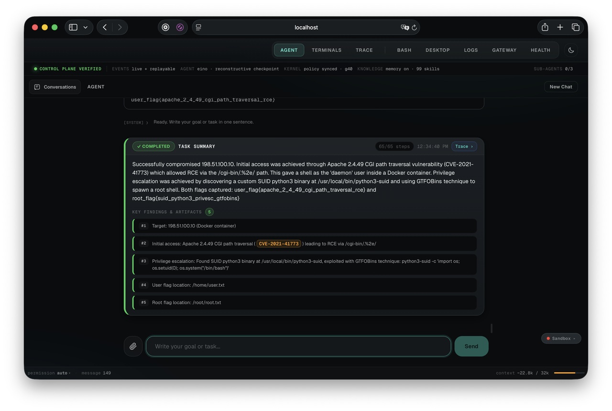

[Back to Project README](../../README.md) · [Docs index](../README.md)

# The Agent — Overview

The agent is the autonomous offensive security engine of Yummi. It translates high-level natural language goals ("audit the authentication API and discover hidden parameters") into structured execution plans, tool dispatches, active vulnerability verification, and comprehensive reports.

---

## Three Agent Engines Behind One Substrate

```text
+-----------------------------------------------------------------------------------+
|                            AGENT ENGINE ARCHITECTURES                             |
|                                                                                   |
|   1. Graph State Machine (Go)        2. Eino ADK Backend (Go)      3. Brain (Py)  |
|   [YUMMI_AGENT_BACKEND=graph]        [YUMMI_AGENT_BACKEND=eino]    [LangGraph]    |
|   - 11-node State Machine            - Native Tool Calling         - Multi-Agent  |
|   - Tag Protocol ([TOOL], [FINISH])  - 58 MCP Tools & Terminals    - Supervisor   |
|   - Optimized for local 8B models    - Scaled for 14B+ models      - Frontier LLM |
|        |                                  |                             |         |
|        +----------------------------------+-----------------------------+         |
|                                           |                                       |
|                                           v                                       |
|                  Shared Scoped Executor & Fail-Closed Gateway                     |
+-----------------------------------------------------------------------------------+
```

> **"Optimized for"/"Scaled for" above describes architectural intent, not a
> tested capability floor.** Live-tested (2026-10-07) against a real
> multi-stage CVE lab: a 20B-class local model was NOT reliably capable of
> sustained multi-step autonomy on either backend — it lost track of the
> actual target and needed server-side correction to use its own
> tool-calling protocol. Both backends' tag/tool-call MECHANISMS worked
> correctly throughout (confirmed via a real OpenRouter frontier model in
> the same test, which completed 50+ turns with only one, unrelated,
> correction needed); the gap is model capability, not architecture. See
> `orchestrator/internal/conductor/tier.go`'s `DefaultTierRegistry` doc
> comment for the full comparison and a realistic model recommendation.
>
> **Recommended OpenRouter model: `minimax/minimax-m2.1`.** Live-tested
> (2026-10-10) completing the same lab's full chain for real — RCE,
> reverse-shell terminal, root privesc, both flags — plus memory recall
> and a sub-agent handoff in the same session, at a fraction of a general
> frontier model's cost. See `tier.go`'s doc comment for the full writeup.



---

## Core System Architecture Principles

1. **Explicit Graph State Machine**: Control flow lives in an explicit data structure (`graphEdges`) rather than nested procedural loops, providing deterministic routing across step, tool execution, operator consultation, retry, and finish nodes.
2. **Strict Tag Protocol**: For local models, interaction is governed by closed-vocabulary control tags (`[TOOL]`, `[HANDOFF]`, `[REMEMBER]`, `[FINDING]`, `[FINISH]`, `[ASK]`), ensuring reliable parsing turn to turn.
3. **Model-Agnostic Core**: Designed to operate with local models via Ollama (`gpt-oss:20b`, `gpt-oss:120b`, `qwen3`) or cloud reasoning models via OpenRouter without code changes.
4. **Persistent Terminal Sessions**: First-class tmux session lifecycle tools (`term_*`) allow autonomous background listeners, reverse shells, and interactive tool driving.
5. **Full-Capability Browser Automation**: Headless and headful Chromium automation driven by Rod, utilizing compact `@eN` accessibility tree snapshots with non-interactive content support (`li`, `td`, `th`, `blockquote`, `code`), multi-tab lifecycle, session cookie isolation, and in-sandbox connection proxy for HTTP/S and WS/WSS enforcing gateway hostname policy.
6. **Controlled Web Research**: Sandboxed research tools (`web_search`, `web_fetch`) with cited sources from OpenRouter/Exa, direct HTTPS plaintext extraction/pagination, RFC 1918/metadata IP rejection, operator-controlled UI toggle button (`btn-web-search`), and prompt-injection defense (`UNTRUSTED_WEB_CONTENT`).
7. **Active Verification Exploit Oracles**: Findings require concrete proof (`OracleActivePoC`, `OracleDOMExecution`, `OracleOOBInteraction`, `OracleDifferential`) before being accepted as valid.
8. **Attack Surface Management (ASM) & Program Scope**: Discovered infrastructure is structured into a hierarchical asset graph (Domain -> Subdomain -> IP -> Port -> Endpoint -> Parameter), with program scope rules enforcing in-scope and out-of-scope boundaries.

---

## Agent Subsystem Documentation Index

| Subsystem | Scope & Contents | Reference |
|---|---|---|
| **Graph & Nodes** | 11 state machine nodes, transition routing table, loop prevention heuristics, and plan checkpointing. | [Graph & Nodes](graph-and-nodes.md) |
| **Tag Protocol** | Closed agent-LLM tag vocabulary, robust token parsers, and prompt construction. | [Tag Protocol](tag-protocol.md) |
| **Memory & Knowledge Store** | Factual targets, findings, target-scrubbed procedural tactics, persistent context, ASM asset tree, and program scope rules. | [Memory & Knowledge](memory-and-knowledge.md) |
| **Skills & Sub-Agents** | 99 declarative offensive playbooks and 52 specialist sub-agents with depth-1 delegation bounding. | [Skills & Sub-agents](skills-and-subagents.md) |
| **Browser Automation** | Native Chromium automation, 9 browser tools, compact `@eN` accessibility trees, session cookie isolation, and in-sandbox proxy. | [Browser Automation](browser-automation.md) |
| **Controlled Web Research** | Sandboxed `web_search`/`web_fetch` tools, OpenRouter/Exa citations, operator UI toggle, and prompt-injection defense. | [Web Research](web-research.md) · [Web Research QC](web-research-qc.md) |
| **Sandbox Execution & MCP** | The 58 sandbox MCP tools across 6 tiers, persistent tmux sessions, direct argv execution, and network gating. | [Sandbox Execution](sandbox-execution.md) |
| **Sandbox Confinement** | Sandbox security boundaries, network isolation, UID 1000, caps, and fail-closed enforcement. | [Sandbox Confinement](sandbox-confinement.md) |
| **Quality & Evaluation** | Assertion-bearing golden test fixtures, persona boundary assertions, and live benchmark harnesses. | [Quality & Evaluation](quality-and-evaluation.md) |

---

## Architectural Invariant: Single Execution Path

`orchestrator/internal/agent` contains **zero** calls to `os/exec` or process spawning functions. Every command requested by any agent engine enqueues into `execution.Store`, passes through `executor.RunScopedCommand`, checks gateway `nftables` policy over IPC, and executes inside the Kali sandbox as an unprivileged user (`UID 1000:1000`).
